# julio-antislop-design

**An agent skill that makes interfaces look designed, not generated.**

A page made by a model looks like the average of every page it has seen: a centred headline, a small label above it, three icon cards, a purple gradient, Inter. Nothing in it is wrong, and nothing in it was decided. Recent studies confirm it: models fill in the brief, but two different briefs produce two nearly identical pages, and a better prompt is not enough to fix that.

`julio-antislop-design` replaces those defaults with a **process**: the idea comes from the subject, the direction comes from real references, a non-negotiable floor protects accessibility, honesty and performance, and the agent looks at what it made before delivering it.

It works with Claude Code, Claude.ai, Codex, Cursor and any [Agent Skills](https://agentskills.io) compatible host. Two editions: **French** (`julio-antislop-design`, the original) and **English** (`julio-antislop-design-en`), with the same rules and the same scripts.

**Score: 7.1 out of 10** in version 0.27 (7.0 in 0.25, 6.8 in 0.24), on 5 fixed briefs, each page built by a fresh agent and scored by an independent judge who only sees the screenshots ([details](evals/README.md)). Honesty 9.0 and first-screen clarity 7.8 lead; spacing 6.2 and originality 6.0 are the next targets.

---

## Contents

- [What the skill does](#what-the-skill-does)
- [Examples](#examples)
- [What's new](#whats-new)
- [Installation](#installation)
- [Usage](#usage)
- [How it works](#how-it-works)
- [What you get](#what-you-get)
- [Recommended tools](#recommended-tools)
- [Repository layout](#repository-layout)
- [Known limits](#known-limits)
- [FAQ](#faq)
- [Contributing](#contributing)
- [Credits](#credits)
- [License](#license)

---

## What the skill does

- **Builds** landing pages, websites, app screens, dashboards, docs and portfolios.
- **Redesigns** an existing screen that "looks AI-made", without changing what the product does.
- **Reviews** a design and says what gives away a generated page, with the fixes.
- **Chooses** a palette, typography and motion from real sources; with no font supplied, it offers you 3 pairings drawn from your subject.
- **Writes the copy** before the code: a fact sheet, a voice of its own, headlines that name what is sold, buttons that say what happens, no stock phrases.
- **Produces** product videos and motion design in code, with a proven workflow.

What sets it apart:

| Principle | In practice |
| --- | --- |
| The idea comes from the subject | An inventory of 8 to 12 elements that belong only to the client, an idea sentence, a competitor test |
| Nothing invented | No imaginary font, component, figure or quote; every decision has a recorded source; stand-in photographs are licensed, credited and listed, never passed off as the client's |
| Out of the average | A roll assigns the composition archetype, constraints and two risks; three first screens compared before building; a déjà-vu test; a log so the next project doesn't repeat this one |
| Rules depend on context | 4 modes (Persuade, Operate, Read, Experience) and, inside Persuade, the kind of business: a café gets photographs, a developer tool gets its own live UI |
| Real models, not imagination | 110 verified model sites by mode, each with the precise quality to borrow and what not to copy |
| Type and spacing as a system | A typeface found in the subject's world (never a model's "reflex" font), a modular type scale, a three-level spacing scale, no eyeballed values |
| Checked, not promised | Token check, copy lint, rendered-page check, automatic detector, screenshots at 4 widths, Core Web Vitals, fresh-eyes critique |

## Examples

Every page below was made by a fresh agent following the skill, with nobody answering its questions and no photographs supplied, then scored out of 10 by an independent judge who only saw the screenshots. The content comes from test briefs; nothing is invented.

### Version 0.27 on the five evaluation briefs

The same five briefs are replayed at every version, so the scores compare. These are the first screens at 1440 px, as the judge saw them; the score in brackets is the 0.25 run of the same brief.

| Lavanila · **Persuade** · 7.4 (7.0) | Fanilo · **Operate** · 7.5 (7.1) |
| --- | --- |
| 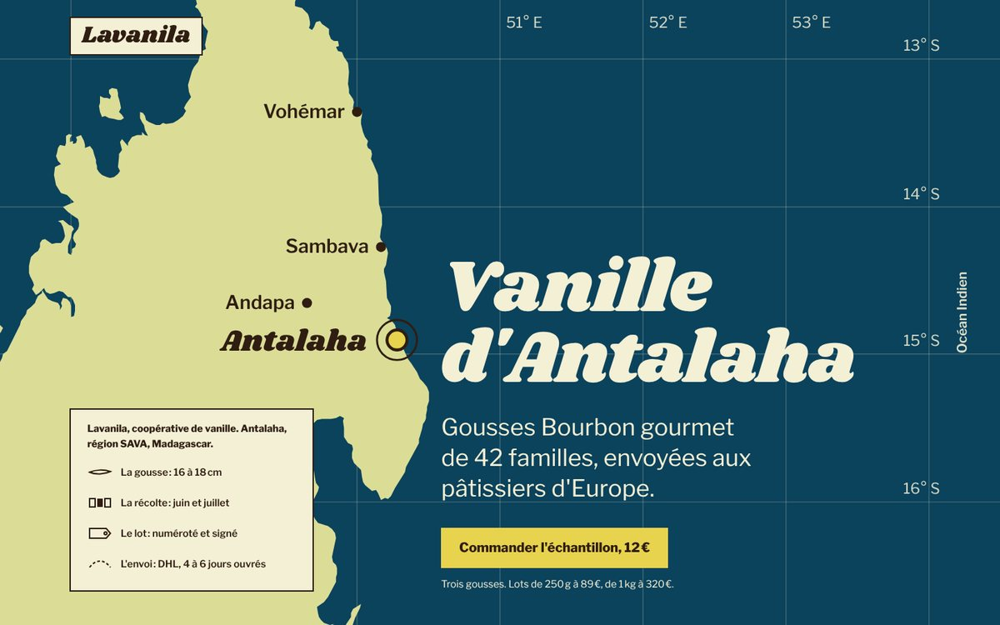 | 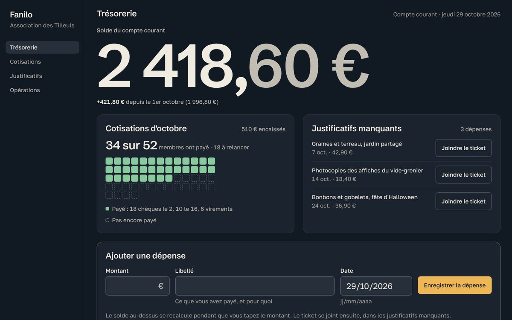 |
| Vanilla cooperative in Madagascar. The whole page is the lot's route, from the Antalaha coast to the pastry chef's kitchen: map, a pod on a ruler, the harvest calendar, a blank lot label, a delivery date computed live. Judge: "a concept drawn from the subject"; weak spot, uneven rhythm on desktop. | Association treasury app. Every figure adds up; dues are a grid of 52 members, and the balance turns amber while you type an expense. Judge: "the visuals come from the subject"; weak spot, the giant balance reads as a fintech habit. |

| Compost guide · **Read** · 7.4 (7.3) | Hery Rasolo · **Experience** · 6.8 (6.1) |
| --- | --- |
| 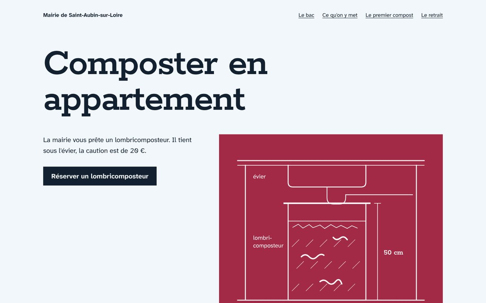 | 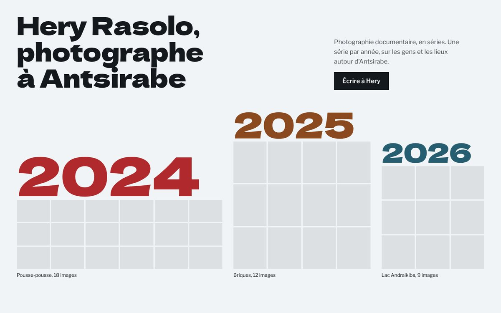 |
| A town hall lends worm composters. A dimensioned drawing shows the bin fits under the sink; you pick a collection Wednesday and the calendar shows when your first compost will be ready. Judge: "content thought of as a tool". | Documentary photographer. Each series takes a width proportional to its number of images, and the frieze is the navigation. Judge: "exemplary honesty"; weak spot, the coloured years shout louder than the photographs will. |

| Les Rayons · **Persuade** · 6.4 (7.6) |
| --- |
| 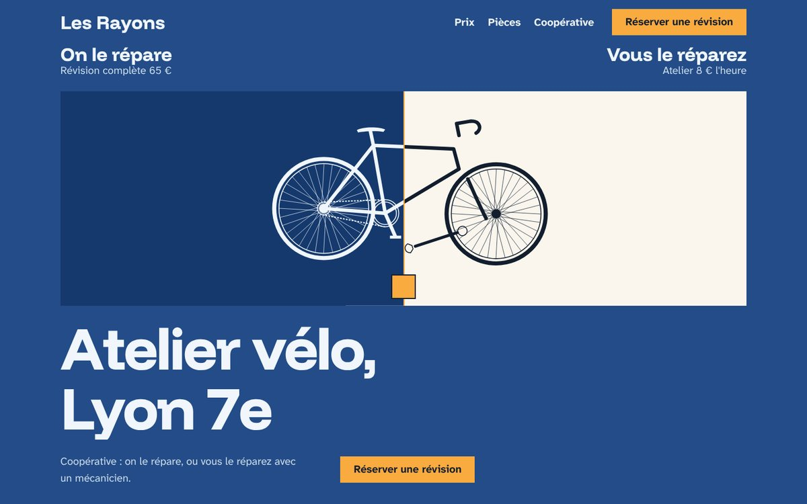 |
| Cooperative bike workshop. The same bike is drawn assembled and in parts, and a slider moves the line between "we repair it" and "you repair it". The judge liked the comparison table and the booking form that computes the return date, but found the split drawing broken and the blue-and-orange look generic: a lower score than 0.25 on this brief, shown as it is. |

Read honestly: +0.1 on average, one run per brief, so luck plays a part. Visuals rose from 6.2 to 6.8 and singularity from 6.6 to 7.4; absence of AI tells fell from 7.8 to 7.2 and finish from 6.4 to 6.2; spacing (6.2) and originality (6.0) did not move. Per-criterion table: [`evals/README.md`](evals/README.md).

### Style gallery (version 0.25)

The skill has no house style: the style comes from your intake answers (the Taste round). Six briefs, six requested styles, ranked by score.

| Pointé · **Clean SaaS** · 8.3 | Atelier Lua · **Minimalist** · 8.3 |
| --- | --- |
| 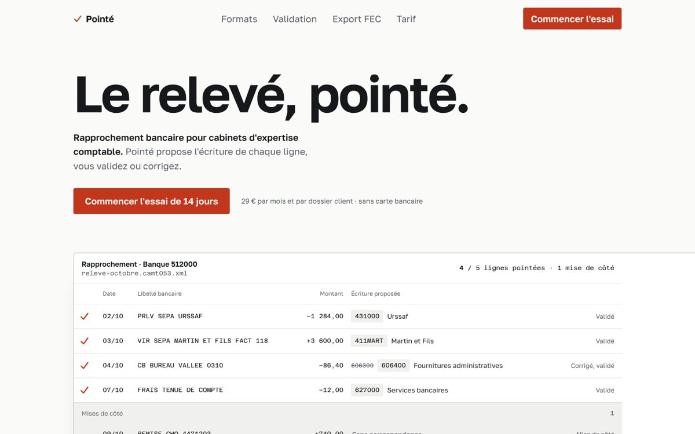 | 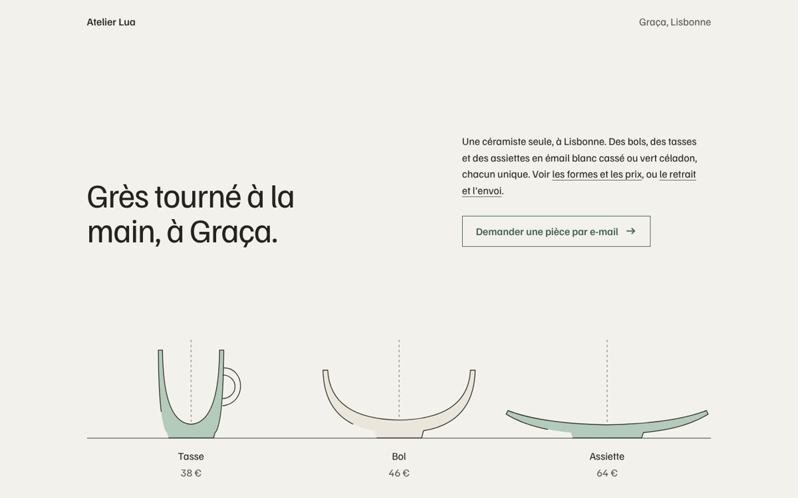 |
| Bank reconciliation tool. The real interface proves reliability instead of claiming it. | Ceramicist in Lisbon. Pieces drawn in cross-section say "hand-thrown" without a single photograph. |

| Teny · **Playful** · 7.8 | Nuit Basse · **Dark and immersive** · 7.3 |
| --- | --- |
| 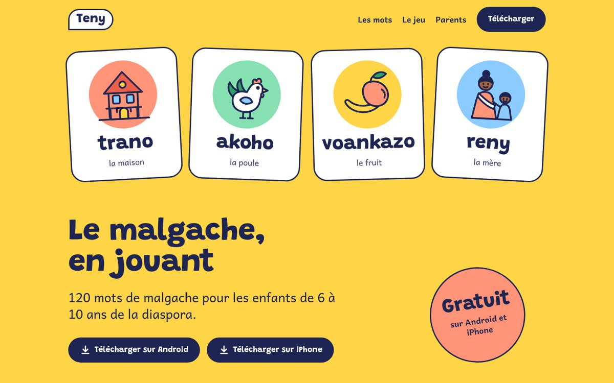 | 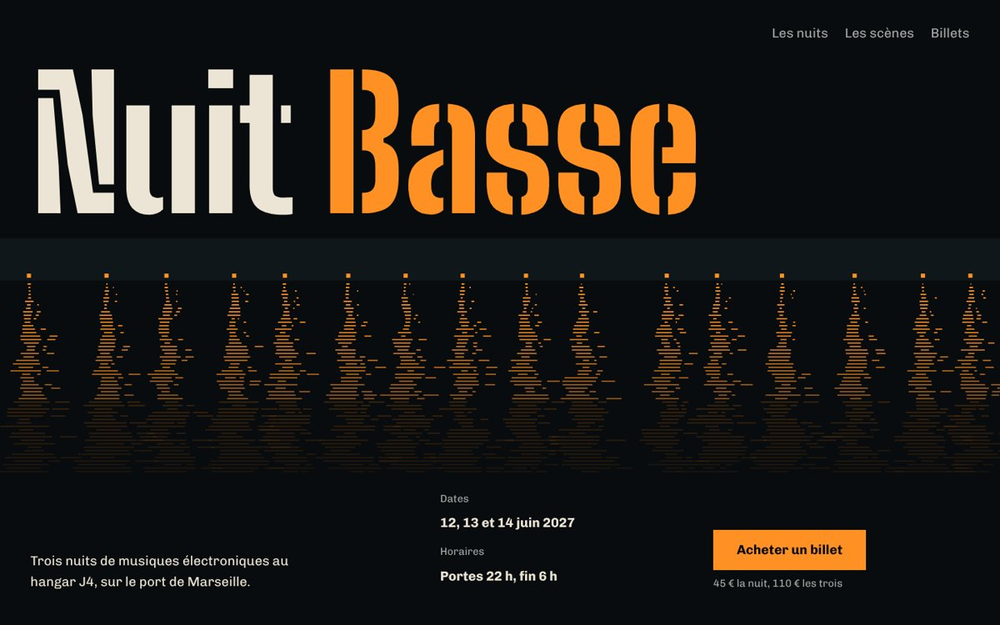 |
| App teaching Malagasy to children. Consistent illustrations and a real, playable memory game. | Electronic music festival on the Marseille docks. The quay's reflections shake to the bass. |

| Terres · **Editorial** · 6.8 | Villa Ambanja · **Quiet luxury** · 6.1 |
| --- | --- |
| 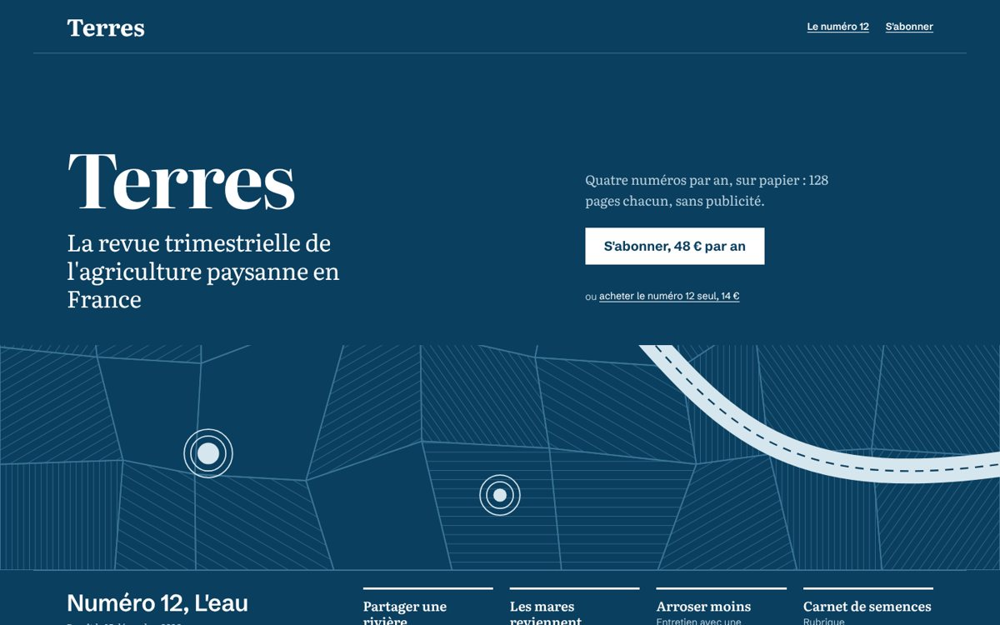 | 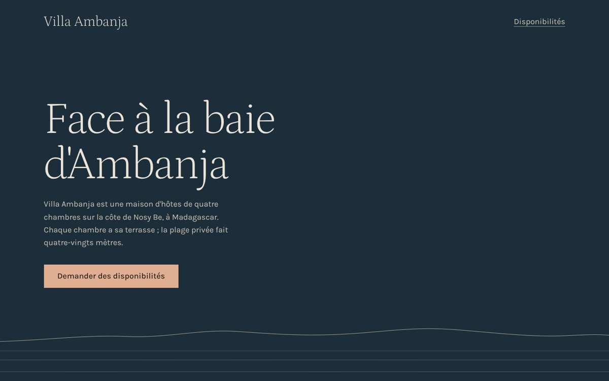 |
| Print magazine on small-scale farming. The cream + serif + terracotta cliché is avoided; the reportage photographs are missing. | Guesthouse in Nosy Be. Slow, sober typography, no black and gold; without photographs, intimate luxury stays too empty. |

Lesson: the skill is at its best when the subject can be shown in code (an interface, drawn objects, a game); styles that live on photography (luxury, editorial) need real images, which the intake asks for, and which licensed stand-ins now cover when the client has none.

### Same brief, version 0.24 then 0.25

| Bike workshop, 0.24: 6.7 | Bike workshop, 0.25: **7.6** |
| --- | --- |
|  |  |
| The price set large, but no bike: the judge read it as a car garage. | The rule "a visual anchor of the subject in the first two screens": the bike and the kraft tags carry the page. |

Detailed scores and briefs: [`evals/README.md`](evals/README.md).

## What's new

| Version | Date | Change |
| --- | --- | --- |
| 0.27 | 9 Nov 2026 | **Taste Skill 2.5 lessons**, rewritten into the skill's own rules: `copy.md` (fact sheet, voice card, headlines that name what is sold, buttons as verb + object, word budget per screen, text tells) and a new `copy-lint.mjs` that checks the copy without a browser; `photos.md` (real photographs first, licensed stand-ins from open collections when the client has none, credits in one footer line, never passed off as the client's); `moments.md` (the hero enters once, one or two chosen moments per page, never a fade-in on every section; shaders and big scenes only for technical subjects); the **kind of business** (software, gaming, hardware, product, service, place) now sets the visual budget inside Persuade; screen rhythm, equal edges and "one system" rules; README in English; **7.1/10** on the 5 evaluation briefs (7.0 in 0.25), with the new first screens in the README |
| 0.26 | 3 Nov 2026 | **The 30 laws of UX** from the Laws of UX catalogue, rewritten from their original sources, each with a rule, a threshold, the modes concerned and a pre-delivery UX check; `check-render` also checks Hick's law (navigation links), Miller's law (long forms) and the Von Restorff effect (one primary action); **rhythm with the person**: every question comes with a recommended answer, four short checkpoints (brief sheet, three first screens, first version, delivery), never a silent wait |
| 0.25 | 3 Nov 2026 | `check-render.mjs` checks the rendered page (broken words, contrast, targets, section rhythm, margins, placeholder text); `visuals.md` (photo-less visuals ranked by score, subject-without-text test); `finish.md` (finish defects and their checks); bilingual scripts; automated tests and CI; blind comparison kit in `benchmark/`; `CHANGELOG.md` |
| 0.24 | 3 Nov 2026 | Lighter: a 9 KB `SKILL.md` with a **quick path** for small requests, the detail in `process.md`; full **English edition**; **evaluation** on 5 briefs (6.8/10) published in `evals/`; "originality never replaces proof"; `check-tokens` detects eyebrows; issue forms, contribution guide, automatic quarterly review; project home page in `docs/`, made with the skill |
| 0.23 | 3 Nov 2026 | Originality: `originality.md` (24 composition archetypes, 16 constraint cards, 8 risk levers, déjà-vu test, wave 5 "clean anti-slop"); `roll.mjs` rolls the direction instead of letting the agent take its first idea; `board.mjs` captures reference sites; `explore.mjs` compares three first screens before building; eliminatory Originality axis in the critique; hollow-content audit in redesigns |
| 0.22 | 3 Nov 2026 | Intake in one go: a Taste round (character, light and colour, fonts, density, shapes, images, motion, liked references and rejections) fills `DESIGN.md` before any code; 12 questions at most, then no more back-and-forth; only an explicit hand-off ("carte blanche") skips it |
| 0.21 | 3 Nov 2026 | `nav-footer.md`: 18 navigation and 15 footer patterns gathered from navbar.gallery, footer.design and unsection.com, each with its use case, rules and a real example |
| 0.20 | 3 Nov 2026 | Lessons from an "Apple style" test: physical product without photographs, glass only when the brief asks (blur something real, never blobs), sample content flagged once, a living thing that changes the main object, a constant section gap |
| 0.19 | 3 Nov 2026 | `site-models.md`: 110 real model sites by mode, each with the quality to borrow; the references step draws on it, including at least one site outside the project's sector |
| 0.18 | 3 Nov 2026 | With no font supplied, the agent offers 3 display + text pairings drawn from the subject and a catalogue of verified fonts (`font-catalog.md`) instead of choosing silently |
| 0.17 | 3 Nov 2026 | Dated list of reflex fonts (including Archivo, caught in the blind test); modular type scale per mode; `spacing.md`; `check-tokens.mjs`; floor A6 extended to sizes and spacing |
| 0.16 | 3 Nov 2026 | Footer and order-form rules, live-computed dates, new tells, from the blind test |
| 0.15 | 2 Nov 2026 | Claude Design–style intake: two rounds of questions, a request for material, a validated brief sheet |

Full history: [`CHANGELOG.md`](CHANGELOG.md).

## Installation

**With the `skills` CLI (Claude Code, Codex, Cursor and other detected agents):**

```bash
npx skills add jrco-dev/julio-antislop-design --skill julio-antislop-design-en   # English edition
npx skills add jrco-dev/julio-antislop-design --skill julio-antislop-design      # French edition
```

Add `-g` to install it for all your projects. Install only one of the two editions in a given project.

**By hand for Claude Code:**

```bash
git clone https://github.com/jrco-dev/julio-antislop-design
cp -r julio-antislop-design/skills/julio-antislop-design-en ~/.claude/skills/     # all projects
# or: cp -r … .claude/skills/   for a single project
```

**On Claude.ai:** download [`dist/julio-antislop-design-en.skill`](dist/julio-antislop-design-en.skill) (or [`dist/julio-antislop-design.skill`](dist/julio-antislop-design.skill) for French) and add it in your skills settings.

Restart your agent after installing.

## Usage

The skill triggers on its own as soon as a task touches how an interface looks. You can also name it. Examples:

```text
Build the landing page for our travel agency in Nosy Be. Audience: European couples, 35-55.
Action: book a call. Photos in ./assets/photos.

Redesign this dashboard, it looks too AI-made: src/app/dashboard/page.tsx

Review this page and tell me what gives it away as generated: http://localhost:3000

Pick a palette and a typeface for a craft coffee brand from the Fianarantsoa region.

Make a 20-second video presenting our app, from real screenshots.

Build a landing page for a ceramic studio in Lisbon. Use julio-antislop-design-en.
```

Before building, the agent runs the intake with you **in one go**, so it knows your taste before the first line of code and avoids back-and-forth: a round on the project (surface, audience, target action, what must exist), a round on taste (character, light or dark, colour, fonts, density, shapes, images, motion, sites you like among its models, what you definitely don't want), a round on material (brand, images, proofs with their source, copy, constraints). 12 questions at most, multiple choice, with previews when possible. With no brand font, it offers 3 pairings. It then shows a brief sheet that starts with "I read this project as: …", has it validated once, fills `DESIGN.md` with your answers, and builds without coming back to you. Say "carte blanche" (free hand) and it decides everything itself, stating its assumptions.

It never leaves you waiting in silence: every question comes with a recommended answer, and it shows its work at four moments (brief sheet, three first screens, first version, delivery), each time with a proposal you can approve in one word.

For a **small request** (a component, a section, a fix, "do it quickly"), it takes the **quick path**: no questions unless something blocks, it follows your `DESIGN.md`, the floor and the tokens, checks, and returns a three-line report.

## How it works

### 1. It chooses the mode

| Mode | The visitor succeeds when… | Examples |
| --- | --- | --- |
| Persuade | they decide and act | Landing, marketing, pricing |
| Operate | they finish a task | App, dashboard, admin |
| Read | they understand | Docs, articles, guides |
| Experience | they are inside the work | Portfolio, gallery |

In Persuade, the **kind of business** then sets the visual budget: a place (café, shop, guesthouse) leads with photographs and type; a product shows the product big and whole; a software tool shows its own live interface; shaders and big scroll scenes are kept for technical subjects. A **redesign** is an action, not a mode: a written audit, a diagnosis, a 5-line direction you approve, then 9 passes in a fixed order.

### 2. It follows a 12-step process

Read the project → intake (questions, material, validated brief sheet) → subject inventory → page-by-page argument → real references → directions away from the average → idea and competitor test → all the copy before the code → build without motion → automatic checks → fresh-eyes critique → motion and delivery.

### 3. It respects an absolute floor

Seven rules that are never lifted:

| | Rule |
| --- | --- |
| A1 | Accessibility, WCAG 2.2 AA: contrast, focus, keyboard, targets, reduced motion |
| A2 | Honesty: no invented proof, figure or feature; sample content is flagged and listed |
| A3 | Traceability: every font, component, image and reference has a real source and a licence that covers the use |
| A4 | Confidentiality: no client data sent to a third-party service without written consent |
| A5 | Performance: Core Web Vitals thresholds (LCP ≤ 2.5 s, INP ≤ 200 ms, CLS ≤ 0.1) |
| A6 | Technical: colours, fonts, sizes and spacing only as tokens, no `transition: all`, no horizontal scroll… |
| A7 | The client's brief wins over the defaults, never over A1 to A6 |

### 4. It applies anti-slop defaults per mode

No eyebrow or letter-spaced capitals label, no purple gradient, no decorative glass, no row of identical cards, no "reflex" font (Inter, Space Grotesk, DM Sans, Archivo, Satoshi, Fraunces…) without a brand reason, no eyeballed sizes or spacing, no stock phrases or "Learn more" buttons, no fade-in on every section, not the cream + terracotta "fix" that became a cliché… Each default can be lifted with a written reason tied to the project. A page that only avoids the bans without asserting anything is rejected: **the bans are not a style.**

### 5. It draws on real sites

At the references step, the agent picks at least 3 sites from `site-models.md` (110 sites by mode: product and brand landing pages, app interfaces, docs and editorial, portfolios and culture), including at least one outside your sector. It opens each site, borrows **one** precise quality (a composition, a grid, a way of naming, a scale), never a page or a brand's identity, and records the URL and the quality in its report.

## What you get

- The code of the page or screen, in your stack.
- `DESIGN.md` (visual system) and `PRODUCT.md` (product context) at the project root, so future requests stay consistent.
- A line in `direction-log.md`, so the next project doesn't look like this one.
- A short report: the chosen direction and the discarded ones, references consulted (URL and borrowed quality), fonts proposed and chosen with their reason, lifted defaults and their reason, check results, credits and licences, stand-in photographs and sample content to replace, and the checks that could not run, named as such.

## Recommended tools

The skill works on its own, but its checks are better with:

| Tool | Role | Install / run |
| --- | --- | --- |
| `scripts/check-tokens.mjs` (included) | Sizes, spacing and fonts outside tokens, reflex fonts, overloaded or cramped scale, eyebrows; Node only, no dependency | `node scripts/check-tokens.mjs <file or folder>`; `--mode operate` for apps, `--allow-font "Name"` for a brand font |
| `scripts/copy-lint.mjs` (included) | The page's text: headline, headings, button labels, stock phrases and slop words, number of hero actions; Node only, no browser | `node scripts/copy-lint.mjs index.html` |
| `scripts/check-render.mjs` (included) | The rendered page: scrolling, broken words, contrast, tiny text, targets, alt, headings, section rhythm, margins, placeholder text; screenshots | `node scripts/check-render.mjs index.html --widths 390,1440 --shots .julio/shots` (Playwright) |
| [Impeccable](https://github.com/pbakaus/impeccable) | Tell and defect detector, no LLM | `npx impeccable detect <file or URL>` |
| `scripts/roll.mjs` (included) | Rolls the direction: archetype, constraint cards, colour, fonts, risks; Node only | `node scripts/roll.mjs --mode persuade --brief "…"` |
| `scripts/board.mjs`, `scripts/explore.mjs` (included) | A board of reference sites; comparison of three first screens | `npm i -D playwright && npx playwright install chromium` |
| [Taste Skill](https://github.com/Leonxlnx/taste-skill) | Optional: its photo search across open collections and its in-browser inspector | Node 22+, Chrome |
| Chrome or Chromium + Node.js | Screenshots at 390, 768, 1440 and 1920 px | Already on most machines |
| Lighthouse | Lab performance | Built into Chrome DevTools |

Without these tools, the agent says so in its report instead of claiming it checked.

## Repository layout

```
skills/julio-antislop-design-en/
├── SKILL.md                     process, floor, essential defaults, delivery
├── references/                  loaded only when the task needs them
│   ├── intake.md                intake: questions, material, brief sheet
│   ├── defaults-by-mode.md      anti-slop rules per mode
│   ├── idea-and-direction.md    inventory, argument, directions, images
│   ├── copy.md                  fact sheet, voice, headlines, buttons, text tells
│   ├── photos.md                real photographs, licensed stand-ins, credits
│   ├── visuals.md               photo-less visuals, ranked by score
│   ├── moments.md               hero entrance, chosen motion moments, what never moves
│   ├── finish.md                finish: defects spotted by the judges and their checks
│   ├── process.md               the 12 steps in detail, delivery, report
│   ├── originality.md           roll, 24 archetypes, constraints, risks, déjà-vu test
│   ├── persuade.md              landing pages, kinds of business, hero, product illustration, bento
│   ├── nav-footer.md            18 navigation patterns, 15 footer patterns
│   ├── operate.md               apps, dashboards, forms, charts
│   ├── read-and-experience.md   docs, articles, portfolios
│   ├── redesign.md              redesign in 9 passes
│   ├── color.md                 building a palette in OKLCH
│   ├── typography.md            reflex fonts, choosing from the subject, modular scale
│   ├── font-catalog.md          verified fonts by subject trait, to propose
│   ├── spacing.md               three-level spacing scale, screen rhythm
│   ├── motion-and-video.md      motion, GPU effects, video in code
│   ├── performance.md           budget per mode
│   ├── tells.md                 tells of generated pages, dated by wave
│   ├── ux-principles.md         the 30 laws of UX, applied; UX check
│   ├── site-models.md           real model sites by mode, quality to borrow
│   ├── resources.md             galleries, libraries, tools, licences
│   └── critique.md              6-axis critique grid
├── scripts/
│   ├── check-tokens.mjs         code check: tokens, reflex fonts, eyebrows
│   ├── copy-lint.mjs            copy check: headline, headings, buttons, stock phrases
│   ├── check-render.mjs         rendered-page check: broken words, contrast, rhythm, margins
│   ├── roll.mjs                 direction roll (archetype, constraints, colour, fonts, risks)
│   ├── board.mjs                captures reference sites as a board
│   └── explore.mjs              compares three first screens
├── templates/                   DESIGN.md, PRODUCT.md, direction log
├── CREDITS.md
└── LICENSE
skills/julio-antislop-design/     French edition (the original), same structure
evals/                            5 briefs, judge prompt, scores per version
benchmark/                        blind comparison kit against other skills
tests/, tools/                    script and structure tests (npm test), packaging
docs/                             project home page, examples, quarterly review
.github/                          issue forms, CI, automatic quarterly review
```

## Known limits

- **Measured on few briefs.** 5 judged briefs, one run each (7.1/10 in 0.27, `evals/`), in a sandbox whose shell has no network (no reference boards, no stand-in photographs) and without a critique sub-agent; the comparison with other skills waits for the test kit run with full network access. Before that, one blind test only (a landing page, against Hallmark and Impeccable, 3 November 2026): ranked first by the author and by an independent judge, but it revealed a reflex font (Archivo) and off-scale sizes and spacing, fixed since (versions 0.17 and 0.18).
- **Model sites are described in text.** Every site in `site-models.md` was confirmed online, but several galleries (Awwwards, Godly, SiteInspire, Commerce Cream) block automated reading, and some visual descriptions are to be confirmed by opening the site, which the skill asks the agent to do.
- **External resources age.** Sites, libraries and licences cited were checked in November 2026; check a licence again before commercial use.
- **It does not replace a designer.** It avoids defects and forces decisions; the final quality still depends on the real material you supply (photographs, copy, data).

## FAQ

**Why does my agent ask questions before coding?**
A model that lacks information fills the gaps with the average, and that is what produces generic pages; guessed taste is then corrected through back-and-forth. It asks all its questions at once (12 at most), never asks what your project or your `DESIGN.md` already says, and shows you a brief sheet to approve once. Say "carte blanche" and it decides everything, stating its assumptions.

**I want a specific style, even if it is among the "tells".**
Say so: an explicit instruction wins over every anti-slop default. It never wins over accessibility, honesty or performance.

**I already have a design system.**
Put it in a `DESIGN.md` at the project root: it takes precedence over the skill's defaults.

**I don't have a brand font.**
The agent offers you 3 pairings, drawn from the lettering of your subject (signs, labels, print) and from a catalogue of verified Google Fonts. You choose; without an answer, it takes the recommended one and writes it down as an assumption.

**I don't have photographs.**
For a place, people or a setting, the agent can use licensed stand-in photographs from open collections (CC0, public domain, CC BY, CC BY-SA), credits them in one footer line and lists each one in its report for you to replace. It never presents a stand-in as your product, your team or your premises; for a product with no photograph, it falls back on the photo-less visuals ranked in `visuals.md`.

**Why does it refuse Inter or Space Grotesk?**
It doesn't refuse them: they are "reflex" fonts that models pick without looking at the subject, so they are guessable. It keeps them if your brand uses them. In an app or dashboard, a sober working font stays allowed for interface text.

**My clients are under NDA.**
Floor A4 forbids sending their data to a third-party service without written consent. Hosted tools (online mockup generators, remote MCP servers) are used only on internal projects or with that consent.

**Does it work with Tailwind, Next.js, Vue, Svelte…?**
Yes. The skill says what to decide; the code follows your stack.

## Contributing

Slop changes fast: a community tracks it better than one person. Three issue forms are ready: **AI-looking page** (the most useful: the exact brief, the agent, screenshots), **new tell spotted** (two unrelated examples), **model site to add** (the precise quality to borrow). Rules and the source hierarchy: [`CONTRIBUTING.md`](CONTRIBUTING.md). Before a pull request: `npm install && npx playwright install chromium && npm test`. History: [`CHANGELOG.md`](CHANGELOG.md).

Every quarter, a "Quarterly review" issue opens automatically to update the tells, reflex fonts, model sites and scores ([procedure](docs/quarterly-review.md)).

## Credits

This skill is a synthesis of several open projects and research works, detailed in [`CREDITS.md`](skills/julio-antislop-design-en/CREDITS.md): Hallmark, Taste Skill (Leonxlnx), Impeccable, UI/UX Pro Max, Stageshow, Design Taste, avoid-ai-design, the original research behind Laws of UX, and unslop by Damir Sokolovsky ([@heydamir](https://x.com/heydamir)), whose redesign variant is adapted. Rules are rewritten in the skill's own words; no code from these projects is included.

## License

[MIT](LICENSE) © 2026 Jimmy Julio.

Exception: `references/redesign.md` is adapted from unslop and remains under the [CC BY 4.0](https://creativecommons.org/licenses/by/4.0/) licence, with mandatory credit to Damir Sokolovsky.
