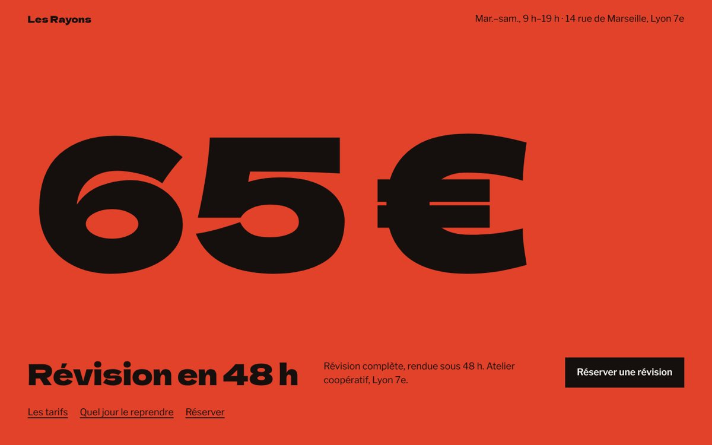
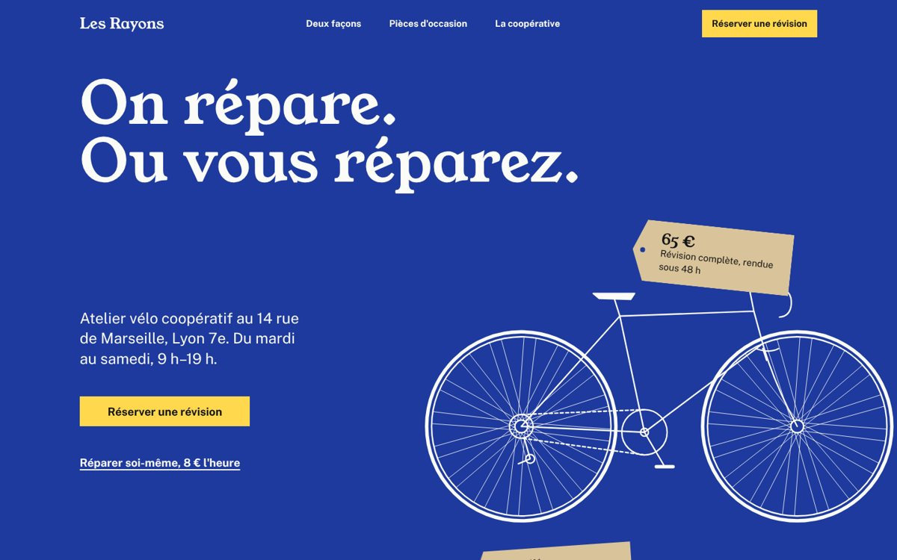
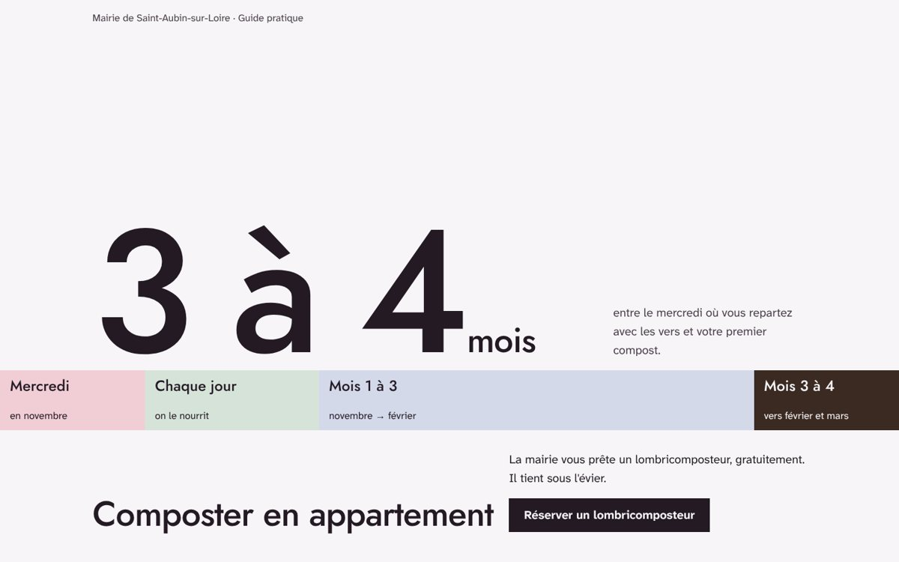
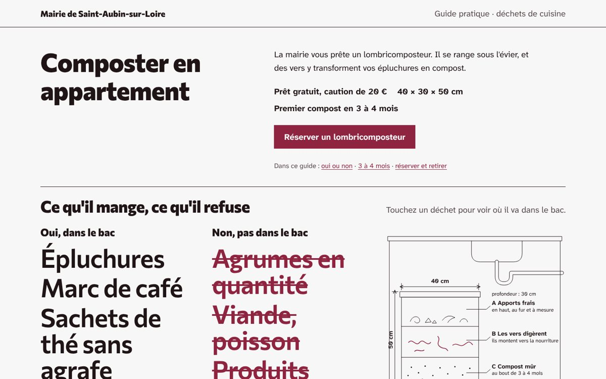
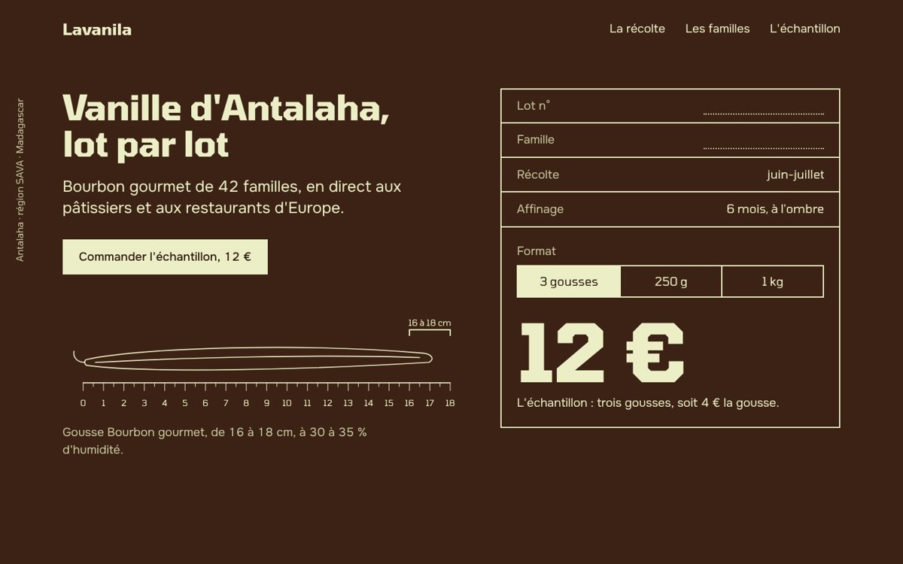
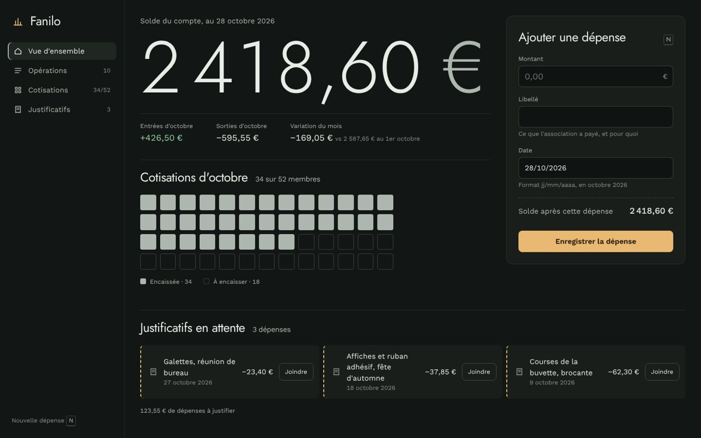

# julio-antislop-design

**Un skill pour agents de code qui fait des interfaces conçues, pas générées.**
*An agent skill that makes interfaces look designed, not generated. [English summary below](#english).*

Une page faite par un modèle ressemble à la moyenne de toutes les pages qu'il a vues : titre centré, petit label au-dessus, trois cartes à icône, un dégradé violet, Inter. Rien n'y est faux, et rien n'y a été décidé. Les études récentes le confirment : les modèles remplissent le brief, mais deux briefs différents donnent deux pages presque identiques, et un meilleur prompt ne suffit pas à corriger ça.

`julio-antislop-design` remplace ces défauts par un **processus** : l'idée vient du sujet, la direction vient de références réelles, un plancher non négociable protège l'accessibilité, l'honnêteté et la performance, et l'agent regarde ce qu'il a fait avant de le livrer.

Il fonctionne avec Claude Code, Claude.ai, Codex, Cursor et tout hôte compatible [Agent Skills](https://agentskills.io). Deux éditions : **française** (`julio-antislop-design`) et **anglaise** (`julio-antislop-design-en`), mêmes règles et mêmes scripts.

**Score : 7,0 sur 10** en version 0.25 (6,8 en 0.24), sur 5 briefs jugés à l’aveugle ([détail](evals/README.md)). Honnêteté 9,0 ; espacement 6,2 et originalité 6,0, les prochains chantiers.

---

## Sommaire

- [Ce que fait le skill](#ce-que-fait-le-skill)
- [Exemples](#exemples)
- [Nouveautés](#nouveautés)
- [Installation](#installation)
- [Utilisation](#utilisation)
- [Comment il travaille](#comment-il-travaille)
- [Ce que vous recevez](#ce-que-vous-recevez)
- [Outils recommandés](#outils-recommandés)
- [Contenu du dépôt](#contenu-du-dépôt)
- [Limites connues](#limites-connues)
- [FAQ](#faq)
- [Contribuer](#contribuer)
- [Crédits](#crédits)
- [Licence](#licence)
- [English](#english)

---

## Ce que fait le skill

- **Crée** des landing pages, sites, écrans d'app, dashboards, docs et portfolios.
- **Refond** un écran existant qui « fait IA », sans changer ce que fait le produit.
- **Relit** un design et dit ce qui trahit une page générée, avec les corrections.
- **Choisit** une palette, une typographie, des animations, en partant de sources réelles ; sans police fournie, il vous propose 3 paires tirées de votre sujet.
- **Produit** des vidéos produit et du motion design en code, avec un workflow éprouvé.

Ce qui le distingue :

| Principe | Concrètement |
| --- | --- |
| L'idée vient du sujet | Inventaire de 8 à 12 éléments propres au client, phrase d'idée, test du concurrent |
| Rien d'inventé | Aucune police, aucun composant, aucun chiffre, aucune citation imaginaires ; chaque décision a une source notée |
| Sortir de la moyenne | Un tirage attribue l'archétype de composition, des contraintes et deux risques ; trois premiers écrans comparés avant de construire ; test du déjà-vu ; journal pour ne pas se répéter |
| Règles selon le contexte | 4 modes (Persuader, Opérer, Lire, Expérience) : un filet discret est normal dans un dashboard et un tic sur une landing |
| Des modèles réels, pas l'imagination | 110 sites modèles vérifiés, classés par mode, chacun avec la qualité précise à emprunter et ce qu'il ne faut pas copier |
| Typographie et espacement en système | Police trouvée dans le monde du sujet (jamais une police « réflexe » des modèles), échelle de tailles modulaire, échelle d'espacement à trois niveaux, aucune valeur au jugé |
| Vérifier, pas promettre | Contrôle des tokens, détecteur automatique, captures à 4 largeurs, Core Web Vitals, critique par un regard neuf |

## Exemples

Pages faites par des agents neufs qui suivaient le skill, sans personne pour répondre ni photo fournie, puis notées sur 10 par un juge indépendant qui ne voyait que les captures ([briefs et notes détaillées](evals/README.md)). Tout le contenu vient des briefs de test ; rien n'est inventé.

**Même brief, version 0.24 puis 0.25** : la 0.25 ajoute la règle « une ancre visuelle du sujet dans les deux premiers écrans », les visuels sans photo classés par note et le contrôle de la page rendue.

| Atelier vélo, 0.24 : 6,7 | Atelier vélo, 0.25 : **7,6** |
| --- | --- |
|  |  |
| Le prix en grand, mais aucun vélo : le juge y voyait un garage auto. | Le vélo et les étiquettes de prix en kraft portent toute la page ; premier écran 9/10. |

| Guide compostage, 0.24 : 6,5 | Guide compostage, 0.25 : **7,3** |
| --- | --- |
|  |  |
| Un chiffre géant avant le sujet, aucun visuel du lombricomposteur (visuels 4/10). | Un schéma coté du bac sous l'évier, 40 × 30 × 50 cm (visuels 8/10). |

**Autres pages de la 0.25**

| Vanille Lavanila : 7,0 | App de trésorerie Fanilo : 7,1 |
| --- | --- |
|  |  |
| La page est l'étiquette du lot ; la gousse sur sa règle de 0 à 18 cm. | Mode Opérer : le solde, les 34 cotisations sur 52, les justificatifs manquants, tout juste à l'euro près. |

Ce ne sont pas des pages finies : les juges y relèvent encore des vides sur desktop, des listes trop grandes et une originalité moyenne (6,0). Les défauts mesurés sont la liste de travail des prochaines versions.

## Nouveautés

| Version | Date | Changement |
| --- | --- | --- |
| 0.25 | 3 nov. 2026 | `check-render.mjs` contrôle la page rendue (mots coupés, contraste, cibles, rythme des sections, marges, textes provisoires) ; `visuals.md` (visuels sans photo classés d'après les notes, test du sujet sans texte) ; `finish.md` (défauts de finition et leurs contrôles) ; scripts bilingues ; tests automatiques et intégration continue ; kit de comparaison dans `benchmark/` ; `CHANGELOG.md` |
| 0.24 | 3 nov. 2026 | Plus léger : `SKILL.md` de 9 Ko avec un **chemin rapide** pour les petites demandes, le détail dans `process.md` ; **édition anglaise** complète ; **évaluation** sur 5 briefs (6,8/10) publiée dans `evals/` ; « l'originalité ne remplace jamais la preuve » ; `check-tokens` détecte les eyebrows ; modèles de tickets, guide de contribution, revue trimestrielle automatique ; page d'accueil du projet dans `docs/`, faite avec le skill |
| 0.23 | 3 nov. 2026 | Originalité : `originality.md` (24 archétypes de composition, 16 cartes de contrainte, 8 leviers de risque, test du déjà-vu, vague 5 « clean anti-slop ») ; `roll.mjs` tire la direction au lieu de laisser l'agent prendre son premier choix ; `board.mjs` capture les sites de référence pour les voir ; `explore.mjs` compare trois premiers écrans avant de construire la page ; axe Originalité éliminatoire dans la critique ; audit du contenu creux en refonte |
| 0.22 | 3 nov. 2026 | Cadrage en une fois : un tour Goût ajouté (caractère, lumière et couleur, polices, densité, formes, images, mouvement, références aimées et rejets) qui remplit `DESIGN.md` avant le code ; 12 questions au plus, puis plus d'aller-retour ; seule une délégation explicite (« carte blanche ») dispense de ce tour |
| 0.21 | 3 nov. 2026 | `nav-footer.md` : 18 modèles de navigation et 15 modèles de pied de page relevés sur navbar.gallery, footer.design et unsection.com, avec le cas d'usage, les règles et un exemple réel ; choix noté dans le rapport |
| 0.20 | 3 nov. 2026 | Leçons du test « style Apple » : produit physique sans photo (registre que le code sait faire, objet entier), règles du verre demandé par le brief (flouter du réel, jamais des blobs), une seule mention du contenu d'exemple, chose vivante qui change l'objet principal, écart entre sections constant |
| 0.19 | 3 nov. 2026 | `site-models.md` : 110 sites modèles réels par mode, avec la qualité à emprunter ; l'étape « références » y puise, dont au moins un site hors du secteur du projet |
| 0.18 | 3 nov. 2026 | Sans police fournie, l'agent propose 3 paires affichage + texte tirées du sujet et d'un catalogue de polices vérifiées (`font-catalog.md`) au lieu de choisir en silence |
| 0.17 | 3 nov. 2026 | Liste datée des polices réflexes (dont Archivo, relevée au test à l'aveugle) ; échelle typographique modulaire par mode ; `spacing.md` ; script `check-tokens.mjs` ; plancher A6 étendu aux tailles et espacements |
| 0.16 | 3 nov. 2026 | Règles de pied de page et de formulaire de commande, dates calculées en direct, nouveaux tics, issus du test à l'aveugle |
| 0.15 | 2 nov. 2026 | Cadrage façon Claude Design : deux tours de questions, demande de matière, fiche brief validée |

## Installation

**Avec le CLI `skills` (Claude Code, Codex, Cursor et autres agents détectés) :**

```bash
npx skills add jrco-dev/julio-antislop-design --skill julio-antislop-design
```

Ajoutez `-g` pour l'installer pour tous vos projets.

**À la main pour Claude Code :**

```bash
git clone https://github.com/jrco-dev/julio-antislop-design
cp -r julio-antislop-design/skills/julio-antislop-design ~/.claude/skills/        # tous les projets
# ou : cp -r … .claude/skills/   dans un seul projet
```

**Édition anglaise :**

```bash
npx skills add jrco-dev/julio-antislop-design --skill julio-antislop-design-en
```

N'installez qu'une des deux éditions dans un même projet.

**Sur Claude.ai :** téléchargez [`dist/julio-antislop-design.skill`](dist/julio-antislop-design.skill) (ou [`dist/julio-antislop-design-en.skill`](dist/julio-antislop-design-en.skill)) et ajoutez-le dans vos paramètres de skills.

Redémarrez votre agent après l'installation.

## Utilisation

Le skill se déclenche seul dès qu'une tâche touche l'apparence d'une interface. Vous pouvez aussi le nommer. Exemples :

```text
Fais la landing page de notre agence de voyages à Nosy Be. Public : couples européens, 35-55 ans.
Action : réserver un appel. Photos dans ./assets/photos.

Refonds ce dashboard, il fait trop IA : src/app/dashboard/page.tsx

Relis cette page et dis-moi ce qui trahit une page générée : http://localhost:3000

Choisis une palette et une typo pour une marque de café artisanal de la région de Fianarantsoa.

Fais une vidéo de 20 secondes qui présente notre app, à partir de captures réelles.
```

```text
Build a landing page for a ceramic studio in Lisbon. Use julio-antislop-design.
```

Avant de créer, l'agent cadre le projet avec vous **en une fois**, pour connaître votre goût avant la première ligne de code et éviter les allers-retours : un tour sur le projet (surface, audience, action visée, ce qui doit exister), un tour sur le goût (caractère, clair ou sombre, couleur, polices, densité, formes, images, mouvement, sites que vous aimez parmi ses modèles, ce que vous ne voulez surtout pas), un tour sur la matière (marque, images, preuves avec leur source, textes, contraintes). 12 questions au plus, à choix, avec aperçus quand c'est possible. Sans police de marque, il vous propose 3 paires. Il vous montre ensuite une fiche brief qui commence par « Je lis ce projet comme : … », la fait valider une fois, remplit `DESIGN.md` avec vos réponses, puis construit sans revenir vers vous. Dites « carte blanche » pour qu'il décide tout lui-même en annonçant ses hypothèses.

Pour une **petite demande** (un composant, une section, une correction, « fais vite »), il prend le **chemin rapide** : pas de questions sauf blocage, il respecte votre `DESIGN.md`, le plancher et les tokens, vérifie, et rend un rapport en trois lignes.

## Comment il travaille

### 1. Il choisit le mode

| Mode | Le visiteur réussit quand… | Exemples |
| --- | --- | --- |
| Persuader | il décide et agit | Landing, marketing, tarifs |
| Opérer | il termine une tâche | App, dashboard, admin |
| Lire | il comprend | Docs, articles, guides |
| Expérience | il est dans l'œuvre | Portfolio, galerie |

La **refonte** est une action, pas un mode : audit écrit, diagnostic, direction en 5 lignes que vous validez, puis 9 passes dans un ordre fixe.

### 2. Il suit un processus en 12 étapes

Lire le projet → cadrage (questions, matière, fiche brief validée) → inventaire du sujet → argument page par page → références réelles → directions hors de la moyenne → idée et test du concurrent → tous les textes avant le code → construire sans mouvement → contrôles automatiques → critique par un regard neuf → mouvement et livraison.

### 3. Il respecte un plancher absolu

Sept règles qui ne se lèvent jamais :

| | Règle |
| --- | --- |
| A1 | Accessibilité WCAG 2.2 AA : contrastes, focus, clavier, cibles, mouvement réduit |
| A2 | Honnêteté : aucune preuve, aucun chiffre, aucune fonctionnalité inventés |
| A3 | Traçabilité : chaque police, composant, image et référence a une source réelle |
| A4 | Confidentialité : aucune donnée client envoyée à un service tiers sans accord écrit |
| A5 | Performance : seuils Core Web Vitals (LCP ≤ 2,5 s, INP ≤ 200 ms, CLS ≤ 0,1) |
| A6 | Technique : couleurs, polices, tailles et espacements uniquement en tokens, pas de `transition: all`, pas de défilement horizontal… |
| A7 | Le brief du client l'emporte sur les défauts, jamais sur A1 à A6 |

### 4. Il applique des défauts anti-slop selon le mode

Pas d'eyebrow ni de label en capitales espacées, pas de dégradé violet, pas de verre décoratif, pas de rangée de cartes identiques, pas de police « réflexe » (Inter, Space Grotesk, DM Sans, Archivo, Satoshi, Fraunces…) sans raison de marque, pas de tailles ni d'espacements posés au jugé, pas le « correctif » crème + terracotta devenu cliché… Chaque défaut peut être levé avec une raison écrite liée au projet. Une page qui se contente de respecter les interdits sans rien affirmer est rejetée : **les interdits ne sont pas un style.**

### 5. Il s'inspire de sites réels

À l'étape des références, l'agent choisit au moins 3 sites dans `site-models.md` (110 sites classés par mode : landing pages de produits et de marques, interfaces d'app, docs et éditorial, portfolios et culture), dont au moins un hors de votre secteur. Il ouvre chaque site, emprunte **une qualité** précise (une composition, une grille, une façon de nommer, une échelle), jamais une page ni l'identité d'une marque, et note l'URL et la qualité dans son rapport.

## Ce que vous recevez

- Le code de la page ou de l'écran, dans votre stack.
- `DESIGN.md` (système visuel) et `PRODUCT.md` (contexte produit) à la racine du projet, pour que les prochaines demandes restent cohérentes.
- Une ligne dans `direction-log.md`, pour que le projet suivant ne ressemble pas à celui-ci.
- Un rapport court : direction choisie et directions écartées, références consultées (URL et qualité empruntée), polices proposées et choisies avec leur raison, défauts levés et leur raison, résultats des contrôles, crédits et licences, contenu d'exemple à valider, et les contrôles qui n'ont pas pu tourner, nommés comme tels.

## Outils recommandés

Le skill fonctionne seul, mais ses contrôles sont meilleurs avec :

| Outil | Rôle | Installation |
| --- | --- | --- |
| `scripts/check-tokens.mjs` (inclus) | Tailles, espacements et polices hors tokens, polices réflexes, échelle trop chargée ou trop serrée ; Node seul, sans dépendance | `node scripts/check-tokens.mjs <fichier ou dossier>` ; `--mode operate` en app, `--allow-font "Nom"` pour une police de marque |
| `scripts/check-render.mjs` (inclus) | La page rendue : défilement, mots coupés, contraste, texte minuscule, cibles, alt, titres, rythme des sections, marges, textes provisoires ; captures | `node scripts/check-render.mjs index.html --widths 390,1440 --shots .julio/shots` (Playwright) |
| [Impeccable](https://github.com/pbakaus/impeccable) | Détecteur de tics et de défauts, sans LLM | `npx impeccable detect <fichier ou URL>` |
| `scripts/roll.mjs` (inclus) | Tire la direction : archétype, cartes de contrainte, couleur, polices, risques ; Node seul | `node scripts/roll.mjs --mode persuader --brief "…"` |
| `scripts/board.mjs`, `scripts/explore.mjs` (inclus) | Planche des sites de référence ; comparaison de trois premiers écrans | `npm i -D playwright && npx playwright install chromium` |
| Chrome ou Chromium + Node.js | Captures à 390, 768, 1440 et 1920 px | Déjà présents sur la plupart des postes |
| Lighthouse | Performance en laboratoire | Intégré à Chrome DevTools |

Sans ces outils, l'agent le dit dans son rapport au lieu de prétendre avoir vérifié.

## Contenu du dépôt

```
skills/julio-antislop-design/
├── SKILL.md                     processus, plancher, défauts essentiels, livraison
├── references/                  chargés seulement quand la tâche en a besoin
│   ├── intake.md                cadrage : questions, matière, fiche brief
│   ├── defaults-by-mode.md      règles anti-slop par mode
│   ├── idea-and-direction.md    inventaire, argument, directions, images
│   ├── visuals.md               visuels sans photo, classés d'après les notes obtenues
│   ├── finish.md                finition : défauts relevés par les juges et contrôles
│   ├── process.md               les 12 étapes en détail, livraison, rapport
│   ├── originality.md           tirage, 24 archétypes, contraintes, risques, test du déjà-vu
│   ├── persuade.md              landing pages, hero, illustration produit, bento
│   ├── nav-footer.md            18 modèles de navigation, 15 de pied de page
│   ├── operate.md               apps, dashboards, formulaires, graphiques
│   ├── read-and-experience.md   docs, articles, portfolios
│   ├── redesign.md              refonte en 9 passes
│   ├── color.md                 construire une palette en OKLCH
│   ├── typography.md            polices réflexes, choisir depuis le sujet, échelle modulaire
│   ├── font-catalog.md          polices vérifiées par trait du sujet, à proposer
│   ├── spacing.md               échelle d’espacement à trois niveaux
│   ├── motion-and-video.md      mouvement, effets GPU, vidéo en code
│   ├── performance.md           budget par mode
│   ├── tells.md                 tics de pages générées, datés par vague
│   ├── ux-principles.md         principes de l'UX et leurs sources d'origine
│   ├── site-models.md           sites modèles réels par mode, qualité à emprunter
│   ├── resources.md             galeries, bibliothèques, outils, licences
│   └── critique.md              grille de critique sur 6 axes
├── scripts/
│   ├── check-tokens.mjs         contrôle du code : tokens, polices réflexes, eyebrows
│   ├── check-render.mjs         contrôle de la page rendue : mots coupés, contraste, rythme, marges
│   ├── roll.mjs                 tirage de la direction (archétype, contraintes, couleur, polices, risques)
│   ├── board.mjs                capture des sites de référence en planche
│   └── explore.mjs              comparaison de trois premiers écrans
├── templates/                   DESIGN.md, PRODUCT.md, journal des directions
├── CREDITS.md
└── LICENSE
skills/julio-antislop-design-en/  édition anglaise, même structure
evals/                            5 briefs, consigne du juge, scores par version
benchmark/                        kit de comparaison à l'aveugle avec d'autres skills
tests/, tools/                    tests des scripts et de la structure (npm test), empaquetage
docs/                             page d'accueil du projet, exemples, revue trimestrielle
.github/                          formulaires d'issue, revue trimestrielle automatique
```

## Limites connues

- **Mesuré sur peu de briefs.** 5 briefs jugés (6,8/10, `evals/`), en bac à sable sans réseau et sans sous-agent de critique ; la comparaison avec d'autres skills attend le kit de test lancé avec tout le réseau. Avant cela, un seul test à l'aveugle (une landing, contre Hallmark et Impeccable, 3 novembre 2026) : classé premier par l'auteur et par un juge indépendant, mais il a révélé une police réflexe (Archivo) et des tailles et espacements hors échelle, corrigés depuis (versions 0.17 et 0.18). Ce test a tourné dans un bac à sable sans réseau : la recherche de concept d'Impeccable et les relecteurs en contexte neuf des trois skills n'ont pas pu tourner. Un second test, avec tout le réseau et un brief neuf, est en préparation.
- **Les sites modèles se décrivent en texte.** Chaque site de `site-models.md` a été confirmé en ligne, mais plusieurs galeries (Awwwards, Godly, SiteInspire, Commerce Cream) bloquent la lecture automatique, et certaines descriptions visuelles sont à confirmer en ouvrant le site, ce que le skill demande à l'agent de faire.
- **Rédigé en français.** Les agents le suivent très bien quelle que soit la langue de la demande, et la description déclenche aussi sur des demandes en anglais.
- **Les ressources externes vieillissent.** Sites, bibliothèques et licences cités ont été vérifiés le 3 novembre 2026 ; revérifiez une licence avant un usage commercial.
- **Il ne remplace pas un designer.** Il évite les défauts et force les décisions ; la qualité finale dépend toujours de la matière réelle que vous fournissez (photos, textes, données).

## FAQ

**Pourquoi mon agent me pose-t-il des questions avant de coder ?**
Un modèle qui manque d'information comble les trous avec la moyenne, et c'est ce qui produit des pages génériques ; un goût deviné se corrige ensuite par allers-retours. Il pose toutes ses questions d'un coup (12 au plus), ne demande jamais ce que votre projet ou votre `DESIGN.md` disent déjà, et vous montre une fiche brief à valider une fois. Dites « carte blanche » et il décide tout en annonçant ses hypothèses.

**Je veux un style précis, même s'il figure parmi les « tics ».**
Dites-le : une consigne explicite l'emporte sur tous les défauts anti-slop. Elle ne l'emporte jamais sur l'accessibilité, l'honnêteté ou la performance.

**J'ai déjà un design system.**
Mettez-le dans un `DESIGN.md` à la racine du projet : il prime sur les défauts du skill.

**Je n'ai pas de police de marque.**
L'agent vous en propose 3 paires, tirées des écritures de votre sujet (enseignes, étiquettes, imprimés) et d'un catalogue de polices Google Fonts vérifiées. Vous choisissez ; sans réponse, il prend la recommandée et l'écrit comme hypothèse.

**Pourquoi refuse-t-il Inter ou Space Grotesk ?**
Il ne les refuse pas : ce sont des polices « réflexes », que les modèles prennent sans regarder le sujet, donc devinables. Il les garde si votre marque les utilise. Dans une app ou un dashboard, une police de travail sobre reste permise pour le texte d'interface.

**Mes clients sont sous NDA.**
Le plancher A4 interdit d'envoyer leurs données à un service tiers sans accord écrit. Les outils hébergés (générateurs de maquettes en ligne, serveurs MCP distants) ne sont utilisés que sur projet interne ou avec cet accord.

**Ça marche avec Tailwind, Next.js, Vue, Svelte… ?**
Oui. Le skill dit quoi décider ; le code suit votre stack.

## Contribuer

Le slop change vite : une communauté le suit mieux qu'une seule personne. Trois formulaires d'issue sont prêts : **page qui fait IA** (le plus utile : le brief exact, l'agent, des captures), **nouveau tic repéré** (deux exemples sans lien), **site modèle à ajouter** (la qualité précise à emprunter). Règles et hiérarchie des sources : [`CONTRIBUTING.md`](CONTRIBUTING.md). Avant une pull request : `npm install && npx playwright install chromium && npm test`. Historique : [`CHANGELOG.md`](CHANGELOG.md).

Chaque trimestre, une issue « Revue trimestrielle » s'ouvre automatiquement pour mettre à jour les tics, les polices réflexes, les sites modèles et les scores ([procédure](docs/quarterly-review.md)).

## Crédits

Ce skill est une synthèse de plusieurs projets ouverts et de travaux de recherche, détaillés dans [`CREDITS.md`](skills/julio-antislop-design/CREDITS.md) : Hallmark, Taste Skill, Impeccable, UI/UX Pro Max, Stageshow, Design Taste, avoid-ai-design, et unslop de Damir Sokolovsky ([@heydamir](https://x.com/heydamir)), dont la variante refonte est adaptée. Aucun code de ces projets n'est inclus.

## Licence

[MIT](LICENSE) © 2026 Jimmy Julio.

Exception : `references/redesign.md` est adapté d'unslop et reste sous licence [CC BY 4.0](https://creativecommons.org/licenses/by/4.0/), avec crédit obligatoire à Damir Sokolovsky.

---

## English

**julio-antislop-design** is an agent skill (Claude Code, Claude.ai, Codex, Cursor and any Agent Skills host) for building, redesigning and reviewing landing pages, app screens, dashboards, docs and portfolios that look designed rather than generated.

- **The idea comes from the subject**: an inventory of what belongs only to this client, an idea sentence, and a competitor test.
- **Nothing is invented**: no made-up fonts, components, numbers, quotes or features; every decision has a recorded real source.
- **Out of the average**: a local roll assigns a composition archetype (24), constraint cards and two risk levers so the agent can't take its first idea; three heroes are compared before the full build; a déjà-vu test and an Originality score gate delivery.
- **Rules depend on the mode**: Persuade, Operate, Read, Experience, plus a redesign variant in 9 ordered passes.
- **An absolute floor**: WCAG 2.2 AA accessibility, honesty, traceability, client confidentiality, Core Web Vitals, technical hygiene.
- **Real references, not imagination**: 110 verified model sites by mode, each with the precise quality to borrow and what not to copy.
- **Type and spacing as a system**: a typeface found in the subject's world (never a model's reflex font; with no brand font, the agent offers 3 pairings), a modular type scale and a three-level spacing scale, no eyeballed values.
- **Checked, not promised**: token checker (no raw sizes, spacing or fonts; reflex fonts flagged), automatic detector, screenshots at 4 widths, fresh-eyes critique, and a report that names any check that did not run.

Install the English edition:

```bash
npx skills add jrco-dev/julio-antislop-design --skill julio-antislop-design-en
```

Current score: 7.0/10 in 0.25 (6.8 in 0.24) on 5 blind-judged briefs (`evals/`); strongest on honesty (9.0), weakest on spacing (6.2) and originality (6.0). Small requests take a fast path (no intake rounds, floor and tokens still enforced). Contributions: issue forms for AI-looking pages, new tells and model sites; a quarterly review issue opens automatically. The French edition is the original (`julio-antislop-design`). Licensed MIT © 2026 Jimmy Julio, except `references/redesign.md`, adapted from unslop by Damir Sokolovsky under CC BY 4.0.
